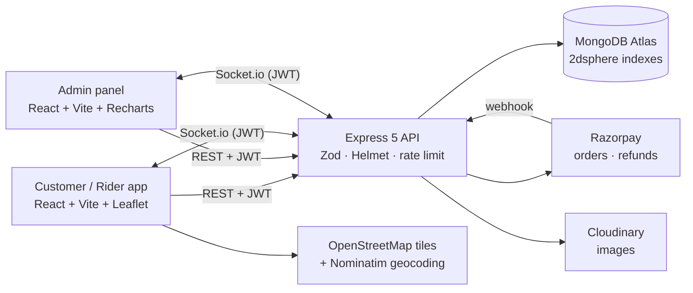

# 🐦 HungryBirds — Food Delivery for Dharwad & Hubli

[](https://github.com/SHARMI-P/hungrybirds/actions/workflows/ci.yml)

A full-stack, real-time food delivery platform with **three apps**: a customer app, a rider app and an admin dashboard. Customers order from local restaurants and pay with Razorpay or cash, then watch their rider move on a live map. Riders get orders assigned automatically to the nearest free rider. Admins run everything from an analytics dashboard.

| App | Link |
|---|---|
| 🍔 Customer + 🛵 Rider app | [hungrybirds-gamma.vercel.app](https://hungrybirds-gamma.vercel.app) |
| ⚙️ Admin panel | [hbadmin.vercel.app](https://hbadmin.vercel.app) |
| 🖥️ API + Swagger docs | [hungrybirds-backend.onrender.com/api/docs](https://hungrybirds-backend.onrender.com/api/docs) |

> The API runs on Render's free tier, so the first request after a while can take ~30 s while it wakes up.

<!-- Add screenshots/GIF here: docs/screenshots/home.png, tracking.gif, admin.png -->

---

## ✨ Features

### Customer
- 📍 **Location-based discovery** — MongoDB `$geoNear` returns restaurants with distance, plus search, cuisine chips, pure-veg filter and sort by distance / rating / fee
- 🧾 **Server-calculated bill** — distance-based delivery fee, GST, minimum order, coupons (`WELCOME50`, `HUNGRY20`…) and an ETA, priced live at checkout
- 🗺️ **Address picker on an OpenStreetMap map** — GPS, search (Nominatim), drag the pin to the door, saved Home/Work addresses
- 💳 **Razorpay** (signature verified + webhook) or **Cash on Delivery**; auto-refund when a paid order is cancelled
- 📦 **Live tracking** — status timeline and the rider's position on a Leaflet map over Socket.io
- ⭐ Ratings & reviews, order history, one-tap **reorder**, cancel before confirmation
- ❤️ **Favourite restaurants** and a favourites filter
- 🗓️ **Scheduled orders**: pick a delivery slot (8 am–11 pm, up to 3 days ahead); the server sends it to the kitchen 45 min before the slot
- 💬 **Chat with your rider** in real time, with quick replies
- 🌐 **ಕನ್ನಡ / English** language switch (remembered per device)
- 📱 **Phone OTP login** (demo mode shows the code on screen; Twilio Verify for real SMS)
- 🔍 Search covers restaurant names, cuisines **and dishes**, and tolerates spelling ("biriyani" → Biryani)

### Rider (log in with a rider account → `/rider`)
- Go online/offline, share live GPS, see pickup & drop on a map with OpenStreetMap directions
- Mark *picked up* / *delivered*; cash-to-collect shown for COD
- Chat with the customer (quick replies: "On my way!", "I'm at your door")
- 🧪 **Simulate ride** button to demo live tracking without moving

### Admin
- 📊 **Dashboard** — revenue, orders per day, status breakdown, top dishes & restaurants (MongoDB aggregation + Recharts)
- 📦 Orders with filters, pagination, **valid next-step buttons only**, manual rider (re)assignment, live 🔔 new-order alerts, release scheduled orders early
- 🗺️ **Live map**: every online rider (free / on delivery) and every active order on one map, updated by GPS in real time
- 🏪 Restaurants & 🍽️ menus with **Cloudinary image upload**, sold-out toggle, edit in place
- 🛵 Riders (creates their login too) · 🎟️ Coupons

---

## 🏗️ Architecture



**Order lifecycle** (enforced on the server by a state machine):

```
awaiting_payment ──► (scheduled ──►) placed ──► confirmed ──► preparing ──► picked_up ──► delivered
        │               │            │             │
        └───────────────┴────────────┴─────────────┴──► cancelled (auto-refund if paid)
```

| Who | Can do |
|---|---|
| Customer | cancel while `scheduled` / `placed` (or before paying) |
| Admin | release scheduled orders, confirm, start preparing, cancel before pickup, assign riders |
| Assigned rider | `picked_up`, `delivered` — only on their own order |

---

## 🔐 Security decisions

- **The browser never sends prices.** It sends menu item IDs and quantities; the server looks up prices and computes fees, discount, GST and the total. The Razorpay order is created for that server-side amount.
- **An order is only marked paid after HMAC verification**, either the checkout signature (`/payment/verify`, which also checks the payment belongs to *your* order) or a signed **Razorpay webhook**. Both paths are idempotent. Late payments on expired checkouts are refunded automatically.
- **Authorization on every route**: an order is visible only to its owner, admins and the assigned rider (others get 404). Socket rooms use the same check and require a JWT.
- **Zod validation** on every input, with unknown fields stripped. That blocks mass assignment (e.g. sending `role: "admin"` or `rating: 5`).
- **Race-safe updates**: riders are claimed atomically, and status changes are conditional on the current status.
- Helmet headers, CORS allow-list, rate limiting (stricter on login), bcrypt, `select: false` on password hashes, central error handler (no stack traces in production), secrets only via environment variables.

---

## 🛠️ Tech stack (all open source)

| Layer | Tools |
|---|---|
| Frontend | React 19, Vite, React Router 7, Leaflet + react-leaflet (OpenStreetMap), Socket.io client, react-hot-toast |
| Admin | React 19, Vite, Recharts |
| Backend | Node 22, Express 5, Mongoose 8, Socket.io, Zod, Helmet, express-rate-limit, Multer, Swagger UI |
| Services | MongoDB Atlas, Razorpay, Cloudinary, OpenStreetMap / Nominatim |
| Quality | Jest + Supertest (real MongoDB), Vitest + Testing Library, ESLint, Prettier, GitHub Actions, Dependabot |
| Deploy | Vercel (frontends), Render (API, `render.yaml`), Docker Compose (local) |

---

## 🚀 Run it locally

**Prerequisites:** Node 20+ and either Docker or a MongoDB connection string (Atlas free tier works).

```bash
git clone https://github.com/SHARMI-P/hungrybirds.git
cd hungrybirds
```

### 1. API

```bash
cd backend
cp .env.example .env        # fill in MONGODB_URI and JWT_SECRET (Razorpay/Cloudinary optional)
npm install
npm run seed                # demo data (21 restaurants, 137 dishes) — prints the admin password
npm run dev                 # http://localhost:5000  ·  docs at /api/docs
```

Or with Docker (MongoDB included):

```bash
docker compose up --build
docker compose exec api node seed.js
```

### 2. Customer app

```bash
cd frontend
cp .env.example .env        # VITE_API_URL=http://localhost:5000/api
npm install
npm run dev                 # http://localhost:3000
```

### 3. Admin panel

```bash
cd admin-panel
cp .env.example .env
npm install
npm run dev                 # http://localhost:3001
```

### Demo accounts (after `npm run seed`)

| Role | Email | Password |
|---|---|---|
| Customer | `test@test.com` | `Demo@12345` (or `SEED_DEMO_PASSWORD`) |
| Rider | `raju@hb.com` (also priya@, suresh@, kavya@, mahesh@hb.com) | `Rider@12345` (or `SEED_RIDER_PASSWORD`) |
| Admin | `admin@hungrybirds.com` | printed by the seed (or `SEED_ADMIN_PASSWORD`) |

**Try the full flow:** order as the customer → confirm and start preparing in the admin panel → log in as the rider in another browser → *Picked up* → *Simulate ride*. The customer's map moves live.

**Already have live data?** Add the extra restaurants without deleting anything:

```bash
node scripts/add-restaurants.js
```

### Tests

```bash
cd backend && npm test         # 55 API tests against a real MongoDB (MONGO_TEST_URI, default localhost)
cd frontend && npm test        # unit tests (Vitest)
npm run lint                   # in any of the three apps
```

---

## 🔧 API overview

Interactive docs: **`/api/docs`** (OpenAPI 3 spec at `/api/openapi.json`).

| Area | Endpoints |
|---|---|
| Auth | `POST /auth/register` · `POST /auth/login` · `GET /auth/me` · `GET/POST/DELETE /auth/addresses` |
| Restaurants | `GET /restaurants/nearby?lat&lng&q&cuisine&veg&sort` · `GET /restaurants/:id` · `/:id/reviews` · admin CRUD |
| Menu | `GET /menu/:restaurantId` · admin CRUD |
| Orders | `POST /orders/quote` · `POST /orders` · `GET /orders/my` · `GET /orders/:id` · `PUT /orders/:id/status` · `POST /orders/:id/cancel` · `POST /orders/:id/review` · admin `GET /orders`, `PUT /orders/:id/assign` |
| Chat | `GET/POST /orders/:id/messages` |
| Favourites | `GET /auth/favorites` · `POST/DELETE /auth/favorites/:restaurantId` |
| Phone OTP | `GET /auth/otp/config` · `POST /auth/otp/send` · `/otp/verify` · `/otp/complete` |
| Payment | `GET /payment/config` · `POST /payment/verify` · `POST /payment/webhook` |
| Riders | `GET /agents/me` · `PUT /agents/me/status` · `PUT /agents/me/location` · admin CRUD |
| Coupons | `GET /coupons` · admin CRUD |
| Admin | `GET /admin/stats` · `GET /admin/live` · `POST /uploads` |

**Socket.io:** connect with `io(URL, { auth: { token } })`, then `join_order`. Events: `order_status_update`, `agent_assigned`, `location_update`, `chat_message`, `new_order` / `agent_location` (admins), `order_assigned` (riders). Riders send `agent_location_update`.

---

## ☁️ Deployment notes

- **Render (API):** root `backend`, start `npm start`, health check `/api/health`. Set `MONGODB_URI`, `JWT_SECRET`, `CLIENT_ORIGINS` (your two Vercel URLs), Razorpay and Cloudinary keys. `render.yaml` has a ready Blueprint.
- **Phone OTP:** set `OTP_PROVIDER=demo` on Render to let visitors try OTP login (the code is shown on screen, no SMS). For real SMS, set `OTP_PROVIDER=twilio` plus `TWILIO_ACCOUNT_SID`, `TWILIO_AUTH_TOKEN`, `TWILIO_VERIFY_SERVICE_SID`.
- **Razorpay webhook:** Dashboard → Webhooks → `https://<api>/api/payment/webhook`, events `payment.captured`, `payment.failed`, `order.paid`, and put the secret in `RAZORPAY_WEBHOOK_SECRET`.
- **Vercel (both frontends):** root `frontend` / `admin-panel`, build `npm run build`, output `build` (`vercel.json` included). Set `VITE_API_URL` (the old `REACT_APP_API_URL` still works).

---

## 🗺️ Roadmap

- Restaurant-owner portal (accept/reject orders, sold-out toggles)
- Push notifications (Web Push) and an installable PWA
- Road-based ETA with OSRM and Playwright end-to-end tests in CI

---

## 👩‍💻 Developer

**Sharmi P** · GitHub [@SHARMI-P](https://github.com/SHARMI-P)

Licensed under the [MIT License](LICENSE).
